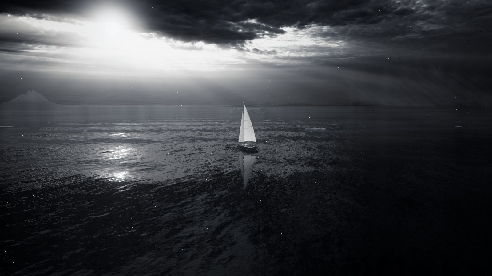

# Seventy-eight north

Sail a 12 m yacht across a cold Arctic sea, in the browser. Built with [three.js](https://threejs.org), plain ES modules, no build step.

**[Play it in your browser](https://sezicz.github.io/seventy-eight-north/)**



- Photographed overcast sky with a sun disk, light shafts, distant snow showers and a procedural coastline
- Gerstner swell plus FFT wind chop, mirror reflections, cloud shadows, sun glitter, wake and bow wave
- Lofted hull, cambered and backlit sails, coverage-faded rigging
- Apparent-wind sailing physics: trim, luffing, stalls, heel, tacking momentum, gybes
- Steep, fluted icebergs and floes with per-pixel ice shading (snow on ledges, a wet waterline, backlit edges), foam lines, light snow, bow spray, sea mist
- A cold, nearly colourless grade and a haze coloured by the sky, shared by the sea, the ice and the yacht
- HDR pipeline: temporal AA, bloom, ACES tone mapping and grading, adaptive resolution

## Run

ES modules need a local web server:

```sh
python3 -m http.server
# open http://localhost:8000
```

On Windows, use `py -m http.server` if `python3` is not available.

The scene needs a recent browser with WebGL and import maps: Chrome or Edge 89+, Firefox 108+ or Safari 16.4+. It also runs on phones, with touch controls. It needs an internet connection, because three.js and the font load from CDNs.

The project is a static site, so GitHub Pages can serve it as it is: in the repository settings, deploy from the root of the main branch.

## Controls

| Action | Touch | Mouse and keyboard |
| --- | --- | --- |
| Steer | Drag the **Helm** pad (springs back) | A / D or ← / → |
| Trim the mainsheet | Slide **Sheet** (up = in) | W (in) / S (out) or ↑ / ↓ |
| Look around | Drag the scene | Drag the scene |
| Zoom | Pinch | Mouse wheel |

The wind dial shows apparent wind (blue arrow), true wind (grey marker) and the boom (line).

## Standalone file

```sh
python3 tools/build.py
```

Writes `dist/seventy-eight-north.html`: one file with the code and images inlined, which opens straight from disk. It still loads three.js and the font from CDNs, so it needs an internet connection. The build script needs only Python 3.10+ and its standard library.

## Project structure

```
index.html              markup, styles, import map for three.js
src/
  main.js               entry point: renderer, world, systems
  core/engine.js        fixed-step loop (update at 60 Hz, render per frame)
  core/util.js          math helpers, seeded random, 3D value noise
  render/assets.js      texture loading, CPU cloud-shadow sampler
  render/sky.js         sun direction, sky shader (photo, coastline, snow showers, sun), haze, sky dome, sky baker
  render/post.js        mirror pass, TAA, bloom, light shafts, tone mapping and grade
  render/resolution.js  adaptive render resolution
  world/waves.js        Gerstner swell, shared by GLSL and JS
  world/sea.js          sea shader, mist, wake tracker
  world/ice.js          icebergs, floes, ice material, foam lines, island
  world/particles.js    snow and bow spray
  yacht/yacht.js        hull, deck, rig, sails, lights; posing on the swell
  sim/input.js          keyboard and touch controls
  sim/sailing.js        wind and sailing physics, collisions
  view/chase-camera.js  chase camera, orbit and zoom
  ui/hud.js             speed, heading, wind dial, hints
assets/                 sky photo and ocean texture
docs/                   screenshot for this README
tools/                  standalone build and asset generators
```

## How it works

- **Sky.** An HDR photo stored as a JPEG with an invertible curve, `(x/(1+x))^(1/2.2)`, so 8 bits carry HDR. The shader decodes and grades it, softens its brightest highlights so the sun gap keeps its cloud edges, and adds the coastline, distant snow showers and the sun disk. The procedural parts (coastline, stratus streaks) never change, so they are baked into small textures once the photo has loaded. The sky is also baked into an environment map that lights the yacht and ice.
- **Sea.** The swell displaces the mesh on the GPU, and `waveAt()` evaluates the same waves on the CPU so floating objects ride the drawn surface. Surface detail comes from a tileable FFT slope texture at three scales. Reflections blend the analytic sky with a mirror render of the yacht and ice by Fresnel.
- **Haze.** The ice, the island and the yacht fade into the same haze as the sea. Its colour is the sky at the horizon in each direction, and it thins with height. See `addHaze()` in `src/render/sky.js`.
- **Sailing.** Apparent wind sets the angle of attack on the sails, limited by the sheet. Lift and drag give drive and heel. The hull has drag and inertia, and steering needs water flow over the rudder.
- **Frame.** Mirror pass, then the main pass (sub-pixel jitter), TAA, snow, bloom, light shafts and composite. See `src/render/post.js`. Resolution adapts to keep the frame rate up (`src/render/resolution.js`).

## Assets and credits

- `assets/sky.jpg`: from [HdrSkyOvercast001](https://ambientcg.com/view?id=HdrSkyOvercast001) by ambientCG, CC0. Re-encode with `tools/encode_sky.py`.
- `assets/ocean-noise.png`: generated by `tools/make_ocean_noise.py`.
- [three.js](https://github.com/mrdoob/three.js) r147, MIT.
- [Figtree](https://fonts.google.com/specimen/Figtree), SIL Open Font License, via Google Fonts.

The asset tools need Python 3 with `pip install -r tools/requirements.txt`. Both reproduce the committed files exactly. To re-encode the sky, download the 8K EXR of HdrSkyOvercast001 and run `python3 tools/encode_sky.py path/to/HdrSkyOvercast001_HDR_8K.exr`.

## License

The code is MIT, see [LICENSE](LICENSE). `assets/sky.jpg` is derived from a CC0 image.
